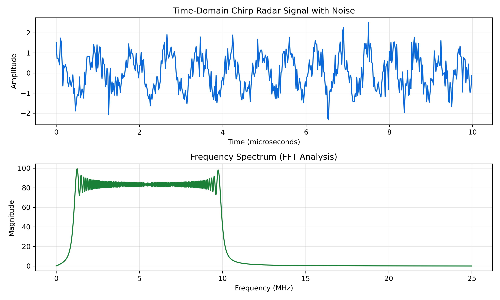

# Radar Signal Modulation & Spectral Analysis

This repository contains numerical modeling and frequency analysis of **Linear Frequency Modulation (LFM / Chirp)** pulses utilized in pulse-compression airborne radar systems.

## Overview
* **Modulation:** Linear Frequency Modulated (LFM) Up-Chirp
* **Analysis:** Fast Fourier Transform (FFT) and SNR evaluation
* **Target Application:** Range resolution enhancement in air target detection

## Output

## Core Technologies
* Python (NumPy, Matplotlib)
* Discrete Signal Processing & Fast Fourier Transforms
